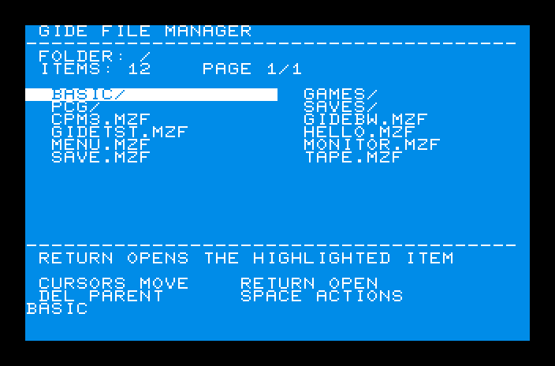

# Sharp MZ-700 retro projects

GIDE storage, replacement monitor firmware and CP/M work for the Sharp MZ-700.

This project was inspired by [UniCard](https://www.sharpwiki.cz/doku.php?id=unicard). I already had a GIDE interface, so chose to explore that route further. The aim is to boot directly from IDE storage, load existing MZ-700 software from a PC-readable card, and provide a practical environment for BASIC and CP/M.

## Components

| Component | Implementation |
| --- | --- |
| Monitor firmware | A replacement 4 KiB boot ROM retains the original public helper entry points and loads an extended RAM monitor from the card. |
| Bootloader and file manager | The ROM, or a small tape-loaded first stage, loads the FAT32 file manager. The interface provides cursor navigation, two columns, alphabetical sorting and catalogue titles. |
| Patched BASIC | Adapted from NOBOMI-SOFT's UniCard MZ-5Z008 BASIC, with GIDE/FAT32 LOAD, SAVE, confirmed overwrite and sequential data files. Startup free memory remains **30,134 bytes**. |
| CP/M 3 | The current release uses **fixed native CP/M volumes**, C: and D:, with the original 40-column display and standard 64 KiB RAM. |
| Diagnostics | ATA register and transfer checks, RTC display and setting, and an optional sector write/verify/restore test. |

The file manager and BASIC already support FAT32. **FAT32 support for CP/M is in development**; the released CP/M build retains its native filesystem and fixed volume offsets. Sharing a card does not give CP/M access to the FAT32 partition.

Work is also under way towards recreating the **SUC 80-column modification** for further CP/M development. The current software requires neither that modification nor expansion RAM.

## Installation

Two boot arrangements are supported:

- **Original Sharp monitor:** load `GIDE-BOOT.MZT` from tape and use the tape card image.
- **Replacement GIDE monitor:** programme the boot ROM and use the ROM card image, which also contains the raw bootstrap sectors and RAM monitor.

The menu variants use different bank-switching arrangements and are not interchangeable. Replacing `MENU.MZF` on an older card does not install the raw sectors required by the replacement ROM.

Binaries, compressed starter images and checksums are available in [release/](release/) and the [GitHub releases](https://github.com/benjamindonnachie/sharp-mz700-retro/releases). The starter images contain the storage software, BASIC and fixed-volume CP/M system, without the games collection.

See [Installation](docs/INSTALLATION.md), [BASIC](docs/BASIC.md), [CP/M](docs/CPM.md), [Diagnostics](docs/DIAGNOSTICS.md), [Monitor interface](docs/MONITOR.md) and [Building](docs/BUILDING.md).

## Hardware and validation

The target is a PAL MZ-700 with 64 KiB RAM, GIDE at **20h**, an ATA master presenting 512-byte sectors and the original 40-column display. A HAL PCG is fitted to the development machine but is not required by the storage system. A 64 KiB image, containing sixteen copies of the 4 KiB monitor, is supplied for a W27C512 used through a suitable adapter.

The fixed-partition CP/M build has booted on the physical Sharp. The replacement EPROM has reached its banner and recovery handler, and the matching CF image has been written and verified by complete readback. A complete ROM-to-menu boot with that updated card has not yet been recorded on the physical machine.

The starter image boots in the emulator, launches BASIC with the expected free memory, and starts CP/M successfully. Further checks cover native SAVE compatibility, recovery and filesystem operations. [Testing](docs/TESTING.md) distinguishes these results from physical validation.

## Development and attribution

**Benjamin Donnachie**, with **OpenAI Codex** as co-author of the code and documentation.

New code is licensed under GPL-3.0-or-later. Original Sharp, NOBOMI-SOFT, Digital Research/DRDOS, SUC and other third-party components retain their respective notices and terms; see [Third-party sources](THIRD-PARTY.md). The next areas of work are recorded in [Roadmap](docs/ROADMAP.md).
